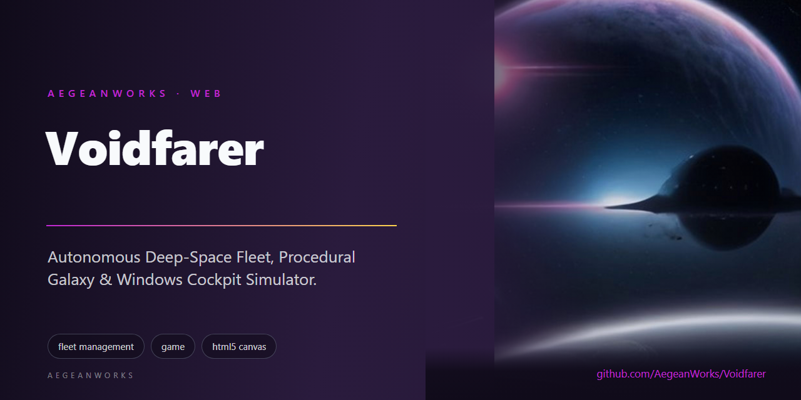
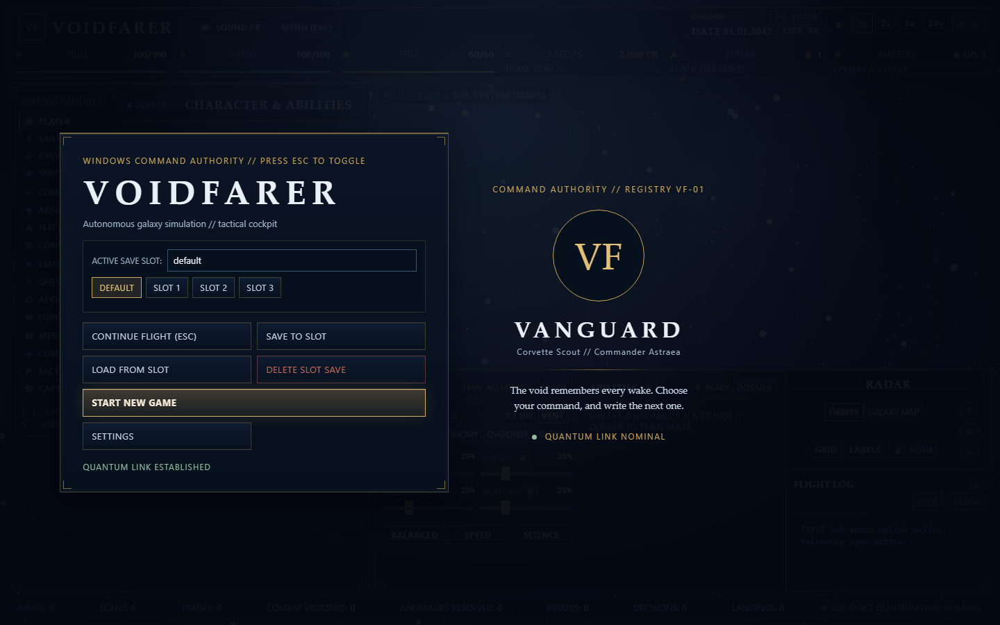

# VoidFarer

<!-- aegean:media:start -->
<p align="center"></p>
<!-- aegean:media:end -->

[](https://github.com/AegeanWorks/AIKit)

> **Autonomous Deep-Space Fleet, Procedural Galaxy & Windows Cockpit Simulator.**

VoidFarer is a zero-dependency, local space flight and exploration simulation. Explore systems, route reactor power, board derelicts, scoop fuel, command drones, fit upgrades, fight AI and trade, from an ANSI REPL or Windows cockpit.

---

## ⚡ 30-Second Cold-Start Quick Reference

### 🎮 1-Click Instant Game Launch (Windows)
Double-click or run either batch launcher directly from Windows Explorer or Terminal:
```cmd
play.bat        # Interactive Mission Launcher (defaults to Windows Cockpit & auto-opens browser)
voidfarer.bat   # CLI passthrough launcher (e.g. `voidfarer.bat status`, `voidfarer.bat repl`)
```

- **Runtime Prerequisites**: Windows 10/11 and Python 3.10+ (Standard Library only; zero third-party packages required).
- **Canonical Regression Shield Gate**:
  ```bash
  python aikit.py check voidfarer
  ```
- **UI inventory proof**: `python tools/ui_inventory.py`

### 🛠️ AIKit Commands (run from the AIKit folder)
| Role | Command |
|---|---|
| Status, task and gates | `python aikit.py status voidfarer` |
| Phase 4: every gate | `python aikit.py check voidfarer` |
| Repair memory and map, then check | `python aikit.py fix voidfarer` |
| Resume an interrupted task | `python aikit.py resume voidfarer` |
| Bounded cockpit UI task | `python aikit.py ui begin voidfarer --surface cockpit` (then `ui verify`) |

---

## 📦 What's Inside

```text
voidfarer/
├── .aikit/               <- project memory: record, ledger, decisions
│   ├── codebase_map.md   <- AST-generated symbol map
│   ├── decisions.md      <- monotonic ADR register
│   ├── guidelines.md     <- project-specific guidelines
│   ├── project.json      <- stack and gate configuration
│   ├── ui.json           <- committed cockpit UI surface contract
│   ├── ui_history.json   <- append-only UI task evidence
│   └── task_ledger.json  <- power-loss safe task state
├── docs/                 <- comprehensive system design & research
│   ├── COCKPIT.md        <- Windows cockpit panels, controls and launch options
│   ├── ATTENTION_MECHANICS_LITERATURE_REVIEW.md <- behavioral psychology review
│   └── NARRATIVE_AND_TUTORIAL_LITERATURE_REVIEW.md <- cognitive load & narrative review
├── .gitignore            <- transient state & python caches excluded
├── LICENSE               <- Aegean Game License 1.1 (AGL-1.1): DRM-free personal play
├── LICENSES/             <- REUSE license texts
├── REUSE.toml            <- Machine-readable SPDX metadata
├── ASSETS.md             <- Asset/data manifest: what the license covers
├── COMMERCIAL.md         <- commercial licensing and support terms
├── pyproject.toml        <- build and package configuration
├── play.bat              <- 1-click interactive Windows launcher (default: Windows Cockpit)
├── voidfarer.bat         <- 1-click Windows CLI passthrough launcher
├── README.md             <- living documentation
├── voidfarer/            <- core simulation package
│   ├── __init__.py       <- package metadata
│   ├── models.py         <- frozen dataclass DTOs and schema validators
│   ├── factions.py       <- sovereign factions, megacorps & standing tiers
│   ├── enemies.py        <- tactical enemy archetypes, abilities & generator
│   ├── galaxy.py         <- procedural star system & hyperlane generator
│   ├── demographics.py   <- world capacity, tech limits & logistic population
│   ├── engine.py         <- deterministic state machine & coordinator
│   ├── reactor.py        <- reactor modes, heat, cooling & derating
│   ├── mapmods.py        <- procedural sector map modifiers
│   ├── shipmods.py       <- structural ship modification catalog
│   ├── character.py      <- commander age, skills & abilities
│   ├── research.py       <- research projects & technology bonuses
│   ├── outposts.py       <- outpost catalogs & tick production
│   ├── faction_state.py  <- faction leaders, behaviors, wars & elimination
│   ├── faction_economy.py <- faction treasuries, tax base, upkeep & war burden
│   ├── faction_trade.py  <- hyperlane trade links between peaceful factions
│   ├── fleet.py          <- escort warships, formations & battle support
│   ├── navigation.py     <- multi-jump routing, void lanes & black-hole hazards
│   ├── messaging.py      <- branching quantum message trees
│   ├── crew.py           <- crew roles, recruiting & portraits
│   ├── away.py           <- away-team expeditions, injuries & crew XP
│   ├── decisions.py      <- blocking conditional events
│   ├── pirates.py        <- pirate bands & toll encounters
│   ├── surface.py        <- landing-party operations
│   ├── weapons.py        <- weapon types & combat modifiers
│   ├── retention.py      <- relics, dynamic contracts & pilot mastery
│   ├── story.py          <- cadet academy, cipher campaign flags & endings
│   ├── upgrades.py       <- hardware upgrades catalog & drone templates
│   ├── economy.py        <- dynamic galactic economy, stockpiles & trade routes
│   ├── frontier.py       <- AI captains, depots, mercenaries & quantum messages
│   ├── exploration.py    <- derelict salvage, fuel scooping & crew drills
│   ├── codex.py          <- discovery codex, career statistics & milestones
│   ├── inventory.py      <- item catalog, consumables & cargo manifest
│   ├── storage.py        <- crash-safe atomic persistence & shadow backup
│   ├── server.py         <- zero-dependency HTTP REST & cockpit server
│   ├── cli.py            <- ANSI terminal interface & interactive REPL
│   └── static/           <- Stellaris-style command console UI
│       ├── index.html    <- semantic HUD structure & radar canvas
│       ├── style.css     <- sci-fi glassmorphism design system
│       ├── app.js        <- radar math, Web Audio synth & REST link
│       ├── celestial.js  <- procedural planet, station & ship models
│       ├── cursor-default.svg <- themed default cockpit cursor
│       ├── cursor-pointer.svg <- themed pointer cursor for controls
│       └── cursor-crosshair.svg <- themed radar crosshair cursor
├── tools/                <- developer proofs
│   ├── __init__.py       <- package marker
│   ├── ui_audit.py       <- layout metrics
│   ├── ui_browser.py     <- real browser review
│   └── ui_inventory.py   <- cockpit inventory proof
└── tests/                <- unit & integration test suite (37 suites)
```

---

## 🚀 Quick Start & CLI Usage

VoidFarer requires only Python 3.10+ and standard library modules.

### 1. Flagship Telemetry Status
```bash
python -m voidfarer.cli status
```
Displays commander dossier, vital telemetry (hull, shields, fuel), reactor power distribution, installed modules, fleet drone count, current system coordinates, and proximity hazard alerts.

### 2. Galaxy Starmap & Celestial Radar
```bash
python -m voidfarer.cli chart
```
Prints hyperlanes, visited flags, security and every local body; each system has 5-6 worlds and a dockable station.

### 3. Navigation & Spaceflight
```bash
# Enter orbit around a planet or space station
python -m voidfarer.cli orbit sol_body_1

# Initiate timed sublight or quantum in-system transit
python -m voidfarer.cli travel sol_body_2 --mode sublight
python -m voidfarer.cli travel sol_body_4 --mode quantum

# Inspect or dismiss cockpit popup events
python -m voidfarer.cli events list
python -m voidfarer.cli events dismiss evt_2_1

# Perform sensor sweep of orbiting body (earns research bounty)
python -m voidfarer.cli scan

# Hyperspace jump to an adjacent star system
python -m voidfarer.cli jump alpha_centauri

# Strip the deterministic derelict at the current body (risk/reward boarding)
python -m voidfarer.cli salvage

# Recover fuel from a star, gas giant, or ice body (adds reactor heat)
python -m voidfarer.cli scoop
```
Scans need 5 MW. Full surveys pay a bonus; salvage advances mining contracts; scoopable bodies hold 3-8 recharging taps.

### 4. Hardware Upgrades & Station Arsenal
```bash
# Inspect available hardware modules and equipped status
python -m voidfarer.cli upgrades

# Purchase and equip an upgrade module
python -m voidfarer.cli upgrades buy warp_booster_mk2
python -m voidfarer.cli upgrades buy subspace_cargo_pods
```

### 5. Autonomous Fleet & Drones
```bash
# List active fleet drones and accumulated harvest yield
python -m voidfarer.cli fleet

# Commission a new drone (mining, scout, or combat_escort)
python -m voidfarer.cli fleet buy mining sol

# Redeploy a drone to another system
python -m voidfarer.cli fleet deploy drone_mining_1 alpha_centauri

# Harvest accumulated resources and credits from fleet
python -m voidfarer.cli fleet harvest
```

### 6. Tactical Combat Maneuvers
When intercepted by hostile corsairs, syndicate marauders, or faction enforcers in low-security space:
```bash
# Tactical maneuvers
python -m voidfarer.cli combat fire             # Laser battery barrage (depletes deflector shields, overflows to hull)
python -m voidfarer.cli combat drone            # Kinetic drone torpedo strike (armor-piercing; bypasses deflector shields)
python -m voidfarer.cli combat target weapons   # Precision strike to disable enemy offensive arrays
python -m voidfarer.cli combat target shields   # Precision strike to destabilize shield harmonic generators
python -m voidfarer.cli combat absorb           # Overcharge deflector shield capacitors
python -m voidfarer.cli combat evade            # High-G thruster burn to dodge telegraphed attacks
python -m voidfarer.cli combat flee             # Emergency hyperspace micro-jump
```

Hostile captains use adaptive AI profiles (`aggressive`, `defensive`, `opportunist`, `adaptive`, `warlord`) that read your hull, shields and tactical combo; the telemetry line shows the next predicted maneuver.

Hostile strength scales +5% hull, shields, damage and bounty per Pilot Mastery level above 1 (capped +75%); Dreadnoughts only ambush level-4+ commanders. Evasive burns cost 3 fuel and reset the combo and streak.

### 7. Dynamic Sector Bounties & Contracts (Zeigarnik Loop)
```bash
# View active contracts, progress bars, and rewards
python -m voidfarer.cli contracts

# Claim completed contract reward and draw replacement assignment
python -m voidfarer.cli contracts claim contract_explore_alpha_centauri
```

### 8. Pilot Mastery & Specializations (Self-Determination)
```bash
# Display Pilot rank, XP progress, and available talent perks
python -m voidfarer.cli mastery

# Unlock specialization perk using earned Talent Points
python -m voidfarer.cli mastery unlock void_cartographer
python -m voidfarer.cli mastery unlock dreadnought_tactics
```

### 9. Ancient Precursor Relics Vault (Variable-Ratio)
```bash
# Inspect recovered alien artifacts and active passive fleet modifiers
python -m voidfarer.cli relics
```

### 10. Expedition Jump Streaks (Loss Aversion)
```bash
# Check current jump streak and cumulative multiplier (+15% up to x2.50)
python -m voidfarer.cli streak
```

### 11. Commodity Commerce & Drydock Services
```bash
# Inspect local exchange prices
python -m voidfarer.cli market

# Buy and sell (max: largest affordable buy; all: whole hold); sales show P/L
python -m voidfarer.cli buy fuel_cells max
python -m voidfarer.cli sell titanium all

# Repair hull damage and refuel
python -m voidfarer.cli repair --amount 25
python -m voidfarer.cli refuel --amount 20

# Inspect the living galactic economy: stockpiles, market shocks, and best trade routes
python -m voidfarer.cli economy

# Inspect the cargo manifest, buy station consumables, and use them in space
python -m voidfarer.cli inventory
python -m voidfarer.cli inventory buy nanite_repair_paste 2
python -m voidfarer.cli inventory use nanite_repair_paste
```

### 12. Cadet Flight Academy (Situated Scaffolding)
```bash
# Check current tutorial milestone and curriculum progress
python -m voidfarer.cli tutorial

# Skip tutorial prompts or reset onboarding curriculum
python -m voidfarer.cli tutorial skip
python -m voidfarer.cli tutorial reset
```

### 13. The Precursor Cipher Narrative Campaign (Space Opera)
```bash
# Display active chapter synopsis, objectives, transmissions log, and moral choices
python -m voidfarer.cli story

# Resolve an episodic narrative dilemma
python -m voidfarer.cli story choose choice_vance_telemetry
```
The five-act campaign keeps persistent flags: later choices can need earlier decisions, locked choices show why, and the finale resolves First VoidFarer, Sentinel or Shadow Broker.

### 13b. The Hollow Between (Void Lane Traversal)
```bash
# Void drive readiness, storm risk, and charted destinations
python -m voidfarer.cli void

# Full deterministic void lane chart for this save seed
python -m voidfarer.cli void lanes

# Slip beyond a black-hole event horizon toward a lane-linked system
python -m voidfarer.cli void dive golconda

# Emergency surfacing back through the entry horizon (costs hull and shields)
python -m voidfarer.cli void emerge
```
Black holes anchor a seeded void-lane graph. Diving needs a horizon orbit, fuel and 25% shields; storms drain stability and add resonance (120 cr, 15 XP each on arrival); `void emerge` banks half, collapse loses all.

### 14. Geopolitical Factions & Megacorporations
```bash
# View all sovereign galactic factions, ideologies, territorial HQs, and standing
python -m voidfarer.cli factions

# View galactic megacorporations, commercial specialties, and trade perks
python -m voidfarer.cli corporations

# Galactic wars: powers, fronts and captures; pledge credits to one side
python -m voidfarer.cli war list
python -m voidfarer.cli war support w_1 vanguard_syndicate 800
```

### 15. Cosmic Calendar & Temporal Clock Controls
```bash
# Check the in-game calendar date, stardate, and active simulation tick
python -m voidfarer.cli time status

# Pause or resume the cosmic simulation clock
python -m voidfarer.cli time pause
python -m voidfarer.cli time resume

# Adjust simulation speed multiplier (1x normal, 2x fast, 5x sub-warp, 10x hyper-warp)
python -m voidfarer.cli time speed 5

# Advance cosmic simulation by a discrete number of ticks (+1, +4, +10)
python -m voidfarer.cli time step 4
```

### 16. Interactive Terminal Cockpit REPL
```bash
python -m voidfarer.cli repl
```
Inside the interactive REPL, all commands work (`status`, `chart`, `time`, `contracts`, `combat`, `story`, `void`, ...); type **`serve`** to launch the concurrent background Web HUD!

Frontier commands are also available directly:
```bash
python -m voidfarer.cli quests
python -m voidfarer.cli ai list
python -m voidfarer.cli ai hail captain_vega
python -m voidfarer.cli messages list
python -m voidfarer.cli messages send "Captain Vega" "Trade lane" "Meeting at Sol."
python -m voidfarer.cli depot status
python -m voidfarer.cli depot deposit titanium 2
python -m voidfarer.cli depot sell titanium 1
python -m voidfarer.cli land sol_body_2
python -m voidfarer.cli mercs list
python -m voidfarer.cli mercs hire merc_ironclad
python -m voidfarer.cli allies list
python -m voidfarer.cli allies form captain_sable
python -m voidfarer.cli saves list
python -m voidfarer.cli saves save slot_1
python -m voidfarer.cli saves load slot_1
```

### 17. Reactor, Map Modifiers & Ship Modifications
```bash
# Reactor thermal simulation: heat, cooling, integrity and operating doctrine
python -m voidfarer.cli reactor status
python -m voidfarer.cli reactor mode overdrive
python -m voidfarer.cli reactor vent
python -m voidfarer.cli reactor repair

# Active sector map modifiers and their economy/combat/thermal effects
python -m voidfarer.cli mapmods

# Structural refit bay: install with credits, remove for salvage value
python -m voidfarer.cli refit list
python -m voidfarer.cli refit install overcharged_core
python -m voidfarer.cli refit remove thermal

# Unified simulation telemetry report
python -m voidfarer.cli simulation
```
Reactor modes trade output against heat: `balanced`, `economy`, `overdrive`, and `silent`.
Heat above 70% derates subsystem power; critical heat damages hull and core integrity.
Sector modifiers (`ion_storm`, `nebula_drift`, `quantum_tide`, etc.) alter jump fuel,
scan yield, encounter risk, trade margins and reactor cooling. Structural refits use five
slots (`frame`, `reactor_core`, `thermal`, `drive`, `ops`) and apply explicit trade-offs.

### 18. Commander, Empire, Diplomacy & Fleet Manager
```bash
python -m voidfarer.cli character status
python -m voidfarer.cli character train science
python -m voidfarer.cli character use emergency_repair

python -m voidfarer.cli research start advanced_cooling
python -m voidfarer.cli outpost list
python -m voidfarer.cli outpost build solar sol_ring_world

python -m voidfarer.cli diplomacy list
python -m voidfarer.cli fleet ships
python -m voidfarer.cli fleet buy_escort frigate
python -m voidfarer.cli route alpha_centauri
python -m voidfarer.cli navigate alpha_centauri
python -m voidfarer.cli combat stance aggressive
python -m voidfarer.cli messages tree
python -m voidfarer.cli messages choose <message_id> <choice_id>
python -m voidfarer.cli crew recruit scientist
python -m voidfarer.cli crew train <crew_id>
python -m voidfarer.cli crew shore
python -m voidfarer.cli away
python -m voidfarer.cli away launch salvage_sweep
python -m voidfarer.cli away recall <mission_id>
python -m voidfarer.cli weapons install railgun
```
The commander ages, earns XP and trains six skills; SHIFT+1..6 fires Overclock, Repair, Battle Focus, Science Burst and rank-7 unlocks. Research unlocks reactor, scan, combat, outpost, repair and fuel tech; outposts repay in 3.9-9.2 months. Wars capture hyperlane fronts; escorts coordinate volleys, screen damage and stances; multi-jump routing handles black holes; message trees branch. Crew roles, morale, wages and portraits react to battles, breaches, storms and campaign beats; unpaid crews below morale 20 risk resignation, and docks sell shore leave. Away teams deploy from orbit for 5-10 ticks: surveys, salvage, xenobiology, relief and distress runs pay credits, research, cargo, standing and crew XP; failures injure specialists, halving their bonus until medbay or time heals them. Bulk orders walk stockpile prices; wages show as net cr/month.

### 18b. Frontier Depth: Pirates, Decisions, Freight & Surface Ops
```bash
python -m voidfarer.cli pirate
python -m voidfarer.cli decision
python -m voidfarer.cli quantum routes
python -m voidfarer.cli quantum ship titanium 2 kepler
python -m voidfarer.cli surface
python -m voidfarer.cli contracts refresh
```
23 systems, 9 factions share the map. Pirate havens force tolls: pay, fight, evade. 35 decisions block time. Quantum freight ships cargo for a fee, paying on arrival. Landed teams survey, core-sample, explore ruins, salvage, or rest. War captures displace civilians and leave scars. Populations scale with world surface, habitability, and tech level, and outposts grow only to their housing ceiling; peaceful neighbours trade along shared hyperlanes and war severs those routes; every faction pays taxes, upkeep, and a wartime burden from its own treasury, and a broke faction sues for peace instead of opening new fronts; faction research slowly raises its technology and the carrying capacity of its worlds. The Sol megastructure is a Dyson swarm of collectors and maintenance habitats, not a solid shell.

### 19. Stellaris-Style Windows Cockpit

The Stellaris-style Windows cockpit, its panels, controls and launch options are documented in
[docs/COCKPIT.md](docs/COCKPIT.md).

### 20. Captain's Log & Discovery Codex
```bash
# Career statistics, discovery overview, and claimed milestone log
python -m voidfarer.cli log

# Discovery codex milestones with category filters
python -m voidfarer.cli codex

# Claim credits and pilot XP for a completed milestone
python -m voidfarer.cli codex claim first_light
```
New System Surveyor and Sector Cartographer milestones track full-system sweeps, and the log reports `systems_surveyed`.

### 21. UI Guard & Visual Audit
`.aikit/ui.json` bounds cockpit work to `voidfarer/static/**` and `voidfarer/server.py`.
`ui_required` is true: tests are the fast proof, `tools/ui_inventory.py` is the snapshot,
`tools/ui_audit.py` measures layout, and `tools/ui_browser.py` drives real Edge screenshots.
See ADR-041 and ADR-047.

---

## 🛡️ Architecture & Resilience Guarantees

1. **Zero External Dependencies**: Built entirely on standard Python modules (`math`, `random`, `dataclasses`, `http.server`, `json`, `pathlib`).
2. **Power-Loss Recovery (PRINCIPLE-013)**: State saves use atomic replacement with file descriptor `fsync`, shadow `.bak` backups, and automatic quarantine of corrupt payloads.
3. **Fast Test Verification**: Comprehensive 676-test suite runs in about 13 seconds (`python -m unittest discover`).
4. **Windows Only**: Windows 10/11, batch launchers, PowerShell-aware console UTF-8, and Windows paths; no Linux/macOS branches or OS-independent claims.
5. **Realistic Mechanics & Economic Integrity**: anti-arbitrage guards, faction tariffs, cargo-volume refit gates, fuel efficiency and cockpit parity.

<!-- aegean:brand-assets:start -->
## 🎨 Brand Assets

> **AI-Generated Brand Artwork.** The banner and logo are **AI-generated brand assets**. They are illustrative and may not literally depict every feature or the full project scope.
<!-- aegean:brand-assets:end -->

## 📜 License

Free for personal play under the Aegean Game License 1.1 (AGL-1.1); see [LICENSE](LICENSE). It is DRM-free: Licensor ships no DRM and a distributor may not add it. Streaming, modding and free mods are allowed. Commercial use, paid mods and AI training need the Aegean Commercial License 1.0 (ACL-1.0); see [COMMERCIAL.md](COMMERCIAL.md).

<!-- aegean:screenshots:start -->
## Screenshots

<a href="https://github.com/AegeanWorks/Voidfarer/commit/1262ed9"></a>

*commit `1262ed9` · 2026-10-28*
<!-- aegean:screenshots:end -->
