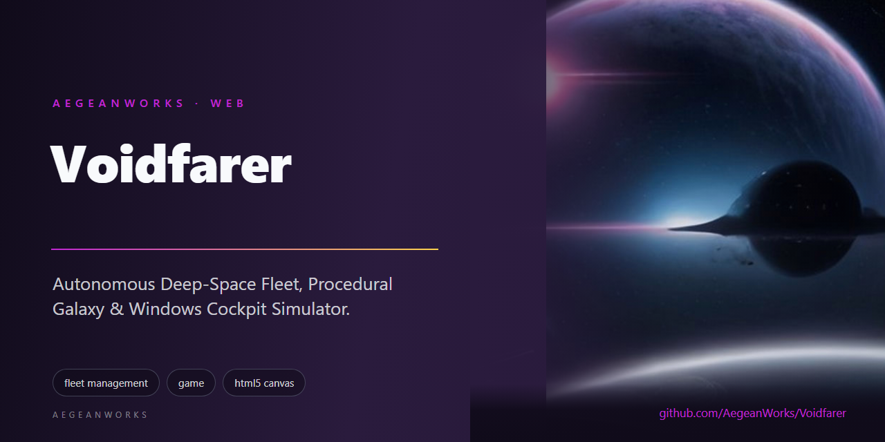
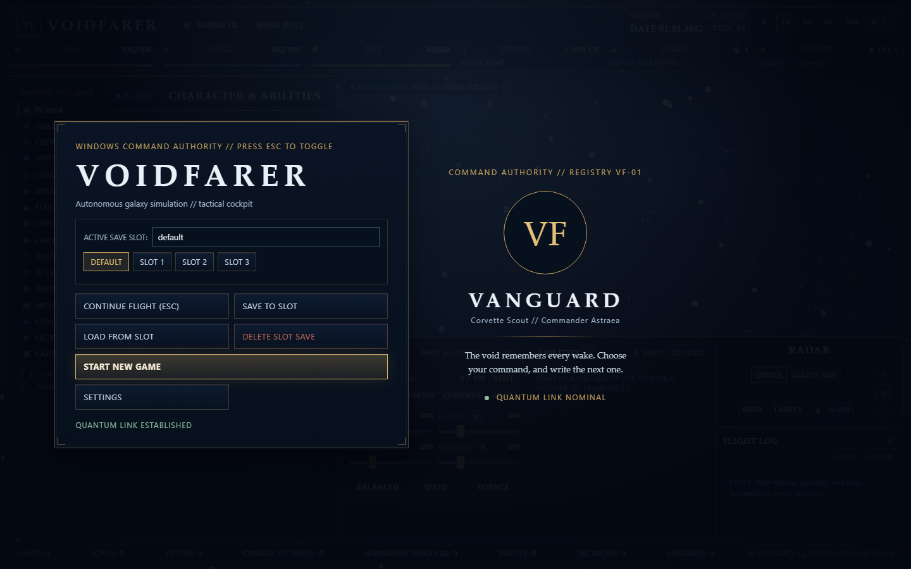

# VoidFarer

<!-- aegean:media:start -->
<p align="center"></p>
<p align="center"><a href="LICENSE"></a> <a href="https://github.com/AegeanWorks/AIKit"></a></p>
<!-- aegean:media:end -->


> **Autonomous Deep-Space Fleet, Procedural Galaxy & Windows Cockpit Simulator.**

VoidFarer is a zero-dependency, local space flight and exploration simulation. Explore systems, route reactor power, board derelicts, scoop fuel, command drones, fit upgrades, fight AI and trade, from an ANSI REPL or Windows cockpit.

---

## ⚡ 30-Second Cold-Start Quick Reference

### 🎮 1-Click Instant Game Launch (Windows)
Double-click or run either batch launcher directly from Windows Explorer or Terminal:
```cmd
play.bat        # Interactive Mission Launcher (defaults to Windows Cockpit & auto-opens browser)
voidfarer.bat   # CLI passthrough launcher (e.g. `voidfarer.bat status`, `voidfarer.bat repl`)
```

- **Runtime Prerequisites**: Windows 10/11 and Python 3.10+ (Standard Library only; zero third-party packages required).
- **Canonical Regression Shield Gate**:
  ```bash
  python aikit.py check voidfarer
  ```
- **UI inventory proof**: `python tools/ui_inventory.py`

### 🛠️ AIKit Commands (run from the AIKit folder)
| Role | Command |
|---|---|
| Status, task and gates | `python aikit.py status voidfarer` |
| Phase 4: every gate | `python aikit.py check voidfarer` |
| Repair memory and map, then check | `python aikit.py fix voidfarer` |
| Resume an interrupted task | `python aikit.py resume voidfarer` |
| Bounded cockpit UI task | `python aikit.py ui begin voidfarer --surface cockpit` (then `ui verify`) |

---

## 📦 What's Inside

```text
voidfarer/
├── .aikit/               <- project memory: record, ledger, decisions
│   ├── codebase_map.md   <- AST-generated symbol map
│   ├── decisions.md      <- monotonic ADR register
│   ├── guidelines.md     <- project-specific guidelines
│   ├── project.json      <- stack and gate configuration
│   ├── media.json        <- approved brand asset manifest
│   ├── ui.json           <- committed cockpit UI surface contract
│   ├── ui_history.json   <- append-only UI task evidence
│   ├── reforge.json      <- crash-safe audit run and repair history
│   └── task_ledger.json  <- power-loss safe task state
├── docs/                 <- comprehensive system design & research
│   ├── COCKPIT.md        <- Windows cockpit panels, controls and launch options
│   ├── ATTENTION_MECHANICS_LITERATURE_REVIEW.md <- behavioral psychology review
│   └── NARRATIVE_AND_TUTORIAL_LITERATURE_REVIEW.md <- cognitive load & narrative review
├── .gitignore            <- transient state & python caches excluded
├── LICENSE               <- Aegean Game License 1.1 (AGL-1.1): DRM-free personal play
├── LICENSES/             <- REUSE license texts
├── REUSE.toml            <- Machine-readable SPDX metadata
├── ASSETS.md             <- Asset/data manifest: what the license covers
├── COMMERCIAL.md         <- commercial licensing and support terms
├── assets/               <- approved logo, social preview & screenshots
│   ├── logo.jpg          <- model-rendered project mark
│   ├── social-preview.png <- README banner and repository preview
│   └── screenshots/      <- committed cockpit captures
├── pyproject.toml        <- build and package configuration
├── play.bat              <- 1-click interactive Windows launcher (default: Windows Cockpit)
├── voidfarer.bat         <- 1-click Windows CLI passthrough launcher
├── README.md             <- living documentation
├── voidfarer/            <- core simulation package
│   ├── __init__.py       <- package metadata
│   ├── models.py         <- frozen dataclass DTOs and schema validators
│   ├── factions.py       <- sovereign factions, megacorps & standing tiers
│   ├── enemies.py        <- tactical enemy archetypes, abilities & generator
│   ├── galaxy.py         <- procedural star system & hyperlane generator
│   ├── demographics.py   <- world capacity, tech limits & logistic population
│   ├── engine.py         <- deterministic state machine & coordinator
│   ├── reactor.py        <- reactor modes, heat, cooling & derating
│   ├── mapmods.py        <- procedural sector map modifiers
│   ├── shipmods.py       <- structural ship modification catalog
│   ├── character.py      <- commander age, skills & abilities
│   ├── research.py       <- research projects & technology bonuses
│   ├── outposts.py       <- outpost catalogs & tick production
│   ├── faction_state.py  <- faction leaders, behaviors, wars & elimination
│   ├── faction_economy.py <- faction treasuries, tax base, upkeep & war burden
│   ├── faction_trade.py  <- hyperlane trade links between peaceful factions
│   ├── fleet.py          <- escort warships, formations & battle support
│   ├── navigation.py     <- multi-jump routing, void lanes & black-hole hazards
│   ├── messaging.py      <- branching quantum message trees
│   ├── crew.py           <- crew roles, recruiting & portraits
│   ├── away.py           <- away-team expeditions, injuries & crew XP
│   ├── decisions.py      <- blocking conditional events
│   ├── pirates.py        <- pirate bands & toll encounters
│   ├── surface.py        <- landing-party operations
│   ├── weapons.py        <- weapon types & combat modifiers
│   ├── retention.py      <- relics, dynamic contracts & pilot mastery
│   ├── story.py          <- cadet academy, cipher campaign flags & endings
│   ├── upgrades.py       <- hardware upgrades catalog & drone templates
│   ├── economy.py        <- dynamic galactic economy, stockpiles & trade routes
│   ├── frontier.py       <- AI captains, depots, mercenaries & quantum messages
│   ├── exploration.py    <- derelict salvage, fuel scooping & crew drills
│   ├── codex.py          <- discovery codex, career statistics & milestones
│   ├── inventory.py      <- item catalog, consumables & cargo manifest
│   ├── logbook.py        <- flight-log windowing that keeps galactic war news
│   ├── storage.py        <- crash-safe atomic persistence & shadow backup
│   ├── server.py         <- zero-dependency HTTP REST & cockpit server
│   ├── agent_api.py      <- action catalog scraped from the server route table
│   ├── agent_play.py     <- deterministic headless captain policy over the REST API
│   ├── cli.py            <- ANSI terminal interface & interactive REPL
│   └── static/           <- Stellaris-style command console UI
│       ├── index.html    <- semantic HUD structure & radar canvas
│       ├── style.css     <- sci-fi glassmorphism design system
│       ├── app.js        <- radar math, Web Audio synth & REST link
│       ├── celestial.js  <- procedural planet, station & ship models
│       ├── cursor-default.svg <- themed default cockpit cursor
│       ├── cursor-pointer.svg <- themed pointer cursor for controls
│       └── cursor-crosshair.svg <- themed radar crosshair cursor
├── tools/                <- developer proofs
│   ├── __init__.py       <- package marker
│   ├── ui_audit.py       <- layout metrics
│   ├── ui_browser.py     <- real browser review and click-map proof
│   ├── ui_inventory.py   <- cockpit inventory proof
│   └── ai_play.py        <- headless AI campaign with mechanic coverage
└── tests/                <- unit & integration test suite (42 suites)
```

---

## 🚀 Quick Start & CLI Usage

VoidFarer requires only Python 3.10+ and standard library modules.

### 1. Flagship Telemetry Status
```bash
python -m voidfarer.cli status
```
Displays commander dossier, vital telemetry (hull, shields, fuel), reactor power distribution, installed modules, fleet drone count, current system coordinates, and proximity hazard alerts.

### 2. Galaxy Starmap & Celestial Radar
```bash
python -m voidfarer.cli chart
```
Prints hyperlanes, visited flags, security and every local body; each system has 7-8 worlds and a dockable station (the Sol and Betelgeuse forges carry eight).

### 3. Navigation & Spaceflight
```bash
# Enter orbit around a planet or space station
python -m voidfarer.cli orbit sol_body_1

# Initiate timed sublight or quantum in-system transit
python -m voidfarer.cli travel sol_body_2 --mode sublight
python -m voidfarer.cli travel sol_body_4 --mode quantum

# Inspect or dismiss cockpit popup events
python -m voidfarer.cli events list
python -m voidfarer.cli events dismiss evt_2_1

# Perform sensor sweep of orbiting body (earns research bounty)
python -m voidfarer.cli scan

# Hyperspace jump to an adjacent star system
python -m voidfarer.cli jump alpha_centauri

# Strip the deterministic derelict at the current body (risk/reward boarding)
python -m voidfarer.cli salvage

# Recover fuel from a star, gas giant, or ice body (adds reactor heat)
python -m voidfarer.cli scoop
```
Scans need 5 MW. Full surveys pay a bonus; salvage advances mining contracts; scoopable bodies hold 3-8 recharging taps.

### 4. Hardware Upgrades & Station Arsenal
```bash
# Inspect available hardware modules and equipped status
python -m voidfarer.cli upgrades

# Purchase and equip an upgrade module
python -m voidfarer.cli upgrades buy warp_booster_mk2
python -m voidfarer.cli upgrades buy subspace_cargo_pods
```

### 5. Autonomous Fleet & Drones
```bash
# List active fleet drones and accumulated harvest yield
python -m voidfarer.cli fleet

# Commission a new drone (mining, scout, or combat_escort)
python -m voidfarer.cli fleet buy mining sol

# Redeploy a drone to another system
python -m voidfarer.cli fleet deploy drone_mining_1 alpha_centauri

# Harvest accumulated resources and credits from fleet
python -m voidfarer.cli fleet harvest
```

### 6. Tactical Combat Maneuvers
When intercepted by hostile corsairs, syndicate marauders, or faction enforcers in low-security space:
```bash
# Tactical maneuvers
python -m voidfarer.cli combat fire             # Laser battery barrage (depletes deflector shields, overflows to hull)
python -m voidfarer.cli combat drone            # Kinetic drone torpedo strike (armor-piercing; bypasses deflector shields)
python -m voidfarer.cli combat target weapons   # Precision strike to disable enemy offensive arrays
python -m voidfarer.cli combat target shields   # Precision strike to destabilize shield harmonic generators
python -m voidfarer.cli combat absorb           # Overcharge deflector shield capacitors
python -m voidfarer.cli combat evade            # High-G thruster burn to dodge telegraphed attacks
python -m voidfarer.cli combat flee             # Emergency hyperspace micro-jump
```

Hostile captains use adaptive AI profiles (`aggressive`, `defensive`, `opportunist`, `adaptive`, `warlord`) that read your hull, shields and tactical combo; the telemetry line shows the next predicted maneuver.

Hostile strength scales +5% hull, shields, damage and bounty per Pilot Mastery level above 1 (capped +75%); Dreadnoughts only ambush level-4+ commanders. Evasive burns cost 3 fuel and reset the combo and streak.

### 7. Dynamic Sector Bounties & Contracts (Zeigarnik Loop)
```bash
# View active contracts, progress bars, and rewards
python -m voidfarer.cli contracts

# Claim completed contract reward and draw replacement assignment
python -m voidfarer.cli contracts claim contract_explore_alpha_centauri
```

### 8. Pilot Mastery & Specializations (Self-Determination)
```bash
# Display Pilot rank, XP progress, and available talent perks
python -m voidfarer.cli mastery

# Unlock specialization perk using earned Talent Points
python -m voidfarer.cli mastery unlock void_cartographer
python -m voidfarer.cli mastery unlock dreadnought_tactics
```

### 9. Ancient Precursor Relics Vault (Variable-Ratio)
```bash
# Inspect recovered alien artifacts and active passive fleet modifiers
python -m voidfarer.cli relics
```

### 10. Expedition Jump Streaks (Loss Aversion)
```bash
# Check current jump streak and cumulative multiplier (+15% up to x2.50)
python -m voidfarer.cli streak
```

### 11. Commodity Commerce & Drydock Services
```bash
# Inspect local exchange prices
python -m voidfarer.cli market

# Buy and sell (max: largest affordable buy; all: whole hold); sales show P/L
python -m voidfarer.cli buy fuel_cells max
python -m voidfarer.cli sell titanium all

# Repair hull damage and refuel
python -m voidfarer.cli repair --amount 25
python -m voidfarer.cli refuel --amount 20

# Inspect the living galactic economy: stockpiles, market shocks, and best trade routes
python -m voidfarer.cli economy

# Inspect the cargo manifest, buy station consumables, and use them in space
python -m voidfarer.cli inventory
python -m voidfarer.cli inventory buy nanite_repair_paste 2
python -m voidfarer.cli inventory use nanite_repair_paste

# Leave a docked broker buying low and selling high while you handle other work
python -m voidfarer.cli autotrade on fuel_cells 55 85 1
python -m voidfarer.cli autotrade status
python -m voidfarer.cli autotrade off
```
Auto-trade buys below its threshold or sells above it once per 3 ticks while docked, respecting cargo, credits, stock and faction pricing. Quantum auto-freight ships surplus cargo on the best net route every 6 ticks above a chosen minimum. The Commerce tab exposes both policies.

### 12. Cadet Flight Academy (Situated Scaffolding)
```bash
# Check current tutorial milestone and curriculum progress
python -m voidfarer.cli tutorial

# Skip tutorial prompts or reset onboarding curriculum
python -m voidfarer.cli tutorial skip
python -m voidfarer.cli tutorial reset
```

### 13. The Precursor Cipher Narrative Campaign (Space Opera)
```bash
# Display active chapter synopsis, objectives, transmissions log, and moral choices
python -m voidfarer.cli story

# Resolve an episodic narrative dilemma
python -m voidfarer.cli story choose choice_vance_telemetry
```
The five-act campaign keeps persistent flags: later choices can need earlier decisions, locked choices show why, and the finale resolves First VoidFarer, Sentinel or Shadow Broker.

### 13b. The Hollow Between (Void Lane Traversal)
```bash
# Void drive readiness, storm risk, and charted destinations
python -m voidfarer.cli void

# Full deterministic void lane chart for this save seed
python -m voidfarer.cli void lanes

# Slip beyond a black-hole event horizon toward a lane-linked system
python -m voidfarer.cli void dive golconda

# Emergency surfacing back through the entry horizon (costs hull and shields)
python -m voidfarer.cli void emerge
```
Black holes anchor a seeded void-lane graph. Diving needs a horizon orbit, fuel and 25% shields; storms drain stability and add resonance (120 cr, 15 XP each on arrival); `void emerge` banks half, collapse loses all.

### 14. Geopolitical Factions & Megacorporations
```bash
# View all sovereign galactic factions, ideologies, territorial HQs, and standing
python -m voidfarer.cli factions

# View galactic megacorporations, commercial specialties, and trade perks
python -m voidfarer.cli corporations

# Galactic wars: powers, fronts and captures; pledge credits to one side
python -m voidfarer.cli war list
python -m voidfarer.cli war support w_1 vanguard_syndicate 800
```

A captain cannot start the Coalition's wars or end others'. If your own polity is at war,
you can send an envoy to petition the enemy leadership
(`diplomacy ceasefire <faction_id>`, 500 cr only if they accept). Wars end by exhaustion,
capture or bankruptcy.

At standing 40, `diplomacy trade_pact <faction_id>` improves buy/sell prices 6% there; war
suspends it.

### 14b. Empty-Space Vectors, NPC Traffic & Decision Cadence

Clicking empty space on the orbital radar selects a vector instead of clearing the
target: `TRANSIT & ORBIT` becomes `MOVE TO VECTOR`, a reticle and dashed course mark the
chosen position, and the same transit animation used for planets flies the ship to it. On
arrival the ship holds station in the void with no body in orbit. The anchor
(`waypoint_au`/`waypoint_angle`) persists in the save and is drawn as
`VF-FLAGSHIP (OPEN SPACE)`; the next transit is priced from that anchor, not from the star.
NPC captains are drawn on both maps (system radar and galaxy) and can be selected and hailed
from their target card.

```bash
# Default is relaxed: at most one blocking decision evaluation per 36 ticks.
# Normal is 18 ticks, frequent 6; a failed roll still consumes its window.
python -m voidfarer.cli settings decisions relaxed
python -m voidfarer.cli settings show
```

### 14c. Headless AI Play & Testable Clicks

Every mechanic is reachable without a human. `GET /api/agent/actions` publishes the
action catalog scraped from the server's own route table, `window.voidfarerClickMap()`
enumerates every cockpit control with a stable `data-testid`, and the bundled captain
plays a full campaign through the same HTTP API the UI uses.

```bash
python tools/ai_play.py --steps 180           # human-readable mechanic coverage
python tools/ai_play.py --steps 180 --json    # machine-readable report
python tools/ui_browser.py --click-map --viewports desktop --out ui-review/clickmap
```

The captain docks, trades, scans, salvages, scoops, lands, runs surface and away
operations, hires and trains crew, buys upgrades, escorts and drones, reads messages,
claims codex rewards, petitions diplomacy, supports wars, vents and repairs the reactor,
and cycles power, stance, time and decision settings. A 180-step run reaches 44
mechanic families, succeeds on 40 endpoints, attempts 53 and reports **zero coverage
gaps**: every POST route in `/api/agent/actions` is either exercised or listed in
`CONTEXT_ACTIONS` with a reason (lifecycle, prompt-driven or requires content the run
cannot create). `tests/test_agent_play.py` fails if a new endpoint appears with neither.

The click-map run enumerates every rendered control through `window.voidfarerClickMap()`
and fails if any control lacks a stable handle or two controls share one (desktop
cockpit: 133 controls, 63 visible, 0 missing, 0 duplicates).

### 15. Cosmic Calendar & Temporal Clock Controls
```bash
# Check the in-game calendar date, stardate, and active simulation tick
python -m voidfarer.cli time status

# Pause or resume the cosmic simulation clock
python -m voidfarer.cli time pause
python -m voidfarer.cli time resume

# Adjust simulation speed multiplier (1x normal, 2x fast, 5x sub-warp, 10x hyper-warp)
python -m voidfarer.cli time speed 5

# Advance cosmic simulation by a discrete number of ticks (+1, +4, +10)
python -m voidfarer.cli time step 4
```

### 16. Interactive Terminal Cockpit REPL
```bash
python -m voidfarer.cli repl
```
Inside the interactive REPL, all commands work (`status`, `chart`, `time`, `contracts`, `combat`, `story`, `void`, ...); type **`serve`** to launch the concurrent background Web HUD!

Frontier commands are also available directly:
```bash
python -m voidfarer.cli quests
python -m voidfarer.cli ai list
python -m voidfarer.cli ai hail captain_vega
python -m voidfarer.cli messages list
python -m voidfarer.cli messages send "Captain Vega" "Trade lane" "Meeting at Sol."
python -m voidfarer.cli depot status
python -m voidfarer.cli depot deposit titanium 2
python -m voidfarer.cli depot sell titanium 1
python -m voidfarer.cli land sol_body_2
python -m voidfarer.cli mercs list
python -m voidfarer.cli mercs hire merc_ironclad
python -m voidfarer.cli allies list
python -m voidfarer.cli allies form captain_sable
python -m voidfarer.cli saves list
python -m voidfarer.cli saves save slot_1
python -m voidfarer.cli saves load slot_1
```

### 17. Reactor, Map Modifiers & Ship Modifications
```bash
# Reactor thermal simulation: heat, cooling, integrity and operating doctrine
python -m voidfarer.cli reactor status
python -m voidfarer.cli reactor mode overdrive
python -m voidfarer.cli reactor vent
python -m voidfarer.cli reactor repair

# Active sector map modifiers and their economy/combat/thermal effects
python -m voidfarer.cli mapmods

# Structural refit bay: install with credits, remove for salvage value
python -m voidfarer.cli refit list
python -m voidfarer.cli refit install overcharged_core
python -m voidfarer.cli refit remove thermal

# Unified simulation telemetry report
python -m voidfarer.cli simulation
```
Reactor modes trade output against heat: `balanced`, `economy`, `overdrive`, and `silent`.
Heat above 70% derates subsystem power; critical heat damages hull and core integrity.
Sector modifiers (`ion_storm`, `nebula_drift`, `quantum_tide`, etc.) alter jump fuel,
scan yield, encounter risk, trade margins and reactor cooling. Structural refits use five
slots (`frame`, `reactor_core`, `thermal`, `drive`, `ops`) and apply explicit trade-offs.

### 18. Commander, Empire, Diplomacy & Fleet Manager
```bash
python -m voidfarer.cli character status
python -m voidfarer.cli character train science
python -m voidfarer.cli character use emergency_repair

python -m voidfarer.cli research start advanced_cooling
python -m voidfarer.cli outpost list
python -m voidfarer.cli outpost build solar sol_ring_world
python -m voidfarer.cli outpost module <outpost_id> laboratory
python -m voidfarer.cli outpost crew <outpost_id> <crew_id>

python -m voidfarer.cli diplomacy list
python -m voidfarer.cli fleet ships
python -m voidfarer.cli fleet buy_escort frigate
python -m voidfarer.cli route alpha_centauri
python -m voidfarer.cli navigate alpha_centauri
python -m voidfarer.cli combat stance aggressive
python -m voidfarer.cli messages tree
python -m voidfarer.cli messages choose <message_id> <choice_id>
python -m voidfarer.cli crew recruit scientist
python -m voidfarer.cli crew train <crew_id>
python -m voidfarer.cli crew shore
python -m voidfarer.cli away
python -m voidfarer.cli away launch salvage_sweep
python -m voidfarer.cli away recall <mission_id>
python -m voidfarer.cli weapons install railgun
```
The commander ages and trains six skills; SHIFT+1..6 fires abilities. Research unlocks reactor, scan, combat, outpost, repair and fuel tech; outposts repay in 4-9 months, stack three modules, and at level 3 choose Industry/Research/Commerce/Logistics (Logistics adds a crew slot). Frontier Shipyards service hull, fuel, escorts and weapons locally. Outposts have integrity; conquest damages them, Sentry Grids/marines reduce the hit, and repairs cost credits. Wars capture fronts; pledges pay 1.5x on victory, 0.8x on stalemate; escorts coordinate volleys and stances; message trees branch. Alliances require standing 70 and cut pirate risk 28%; research pacts at 60 add 5% research; the Empire tab exposes improve, gift, both pacts, alliance and ceasefire. Crew morale, wages and portraits react to battles, breaches, storms and campaign beats; unpaid crews below morale 20 risk resignation. Away teams deploy for 5-10 ticks; surveys, salvage, xenobiology, relief and distress pay credits, research, cargo, standing and XP; failures injure specialists. Research queues; bulk orders walk prices.

### 18b. Frontier Depth: Pirates, Decisions, Freight & Surface Ops
```bash
python -m voidfarer.cli pirate
python -m voidfarer.cli decision
python -m voidfarer.cli quantum routes
python -m voidfarer.cli quantum ship titanium 2 kepler
python -m voidfarer.cli surface
python -m voidfarer.cli contracts refresh
```
32 systems, 9 factions share the map. Pirate havens force tolls: pay, fight, evade. 35 decisions block time, but the default relaxed cadence rolls only once per 36-tick window. Quantum freight ships cargo for a fee, paying on arrival. Landed teams choose from 13 operations: survey, core-sample, explore ruins, salvage, rest, tap geothermal heat, bio-prospect, recover a crash site, drill ice, tap magma, harvest reefs, scoop gas clouds, or deep-mine; environment-specific operations are offered only on matching worlds. War captures displace civilians and leave scars.

### 18c. Post-War Reconstruction & Relief
```bash
# Spend credits to remove 20 devastation from an inhabited world under orbit
python -m voidfarer.cli reconstruct sol_body_1

# Or deliver 2 medicines + 2 hydroponics + 1 fuel cell for 40 devastation
python -m voidfarer.cli reconstruct sol_body_1 --relief

# The same actions are on the target card and POST /api/reconstruct
```
Rebuilding earns standing with the world's owner and feeds the Rebuilder / Relief Runner codex milestones. Devastated markets pay a relief premium for medicines, food, fuel and construction goods, so running supplies into a war zone is a real trade. Wars whose belligerent has no territory left are closed and reported instead of lingering as phantom fronts.

### 18d. Boarding & Prize Capture
```bash
# Collapse the enemy shield first, then cripple its hull below 30%
python -m voidfarer.cli combat fire

# With an active marine aboard, send the boarding party across
python -m voidfarer.cli combat board
```
A successful boarding ends the fight and takes the crippled hull as a fleet prize: it keeps its remaining hull, half its weapon damage and 8% evasion, but pays no full bounty or salvage. A failed boarding injures the lead marine, costs crew morale, resets the tactical combo and lets the enemy counter-attack. The combat card gates `BOARD & CAPTURE` on shields down, hull below 30% and an active marine; the Privateer codex milestone tracks the first prize. At a drydock, the fleet manager shows each escort's resale value and offers `fleet sell_escort <id>`; the Shipbreaker milestone tracks liquidated hulls.

### 18e. Fleet Deployment & Patrols
```bash
# Station an escort in a system; only local ships join the flagship's battles
python -m voidfarer.cli fleet assign <escort_id> <system_id>

# See total versus local formation damage and screen evasion
python -m voidfarer.cli fleet ships
```
Remote escorts are marked `PATROL` and fight only locally. Each cuts local pirate risk up to 75%. Patrols sweep every 6 ticks for XP or a bounty and return fire. Cards show deployment and service records. Escorts cost 30-110 cr/month; unpaid upkeep leaves them damaged. Roles cycle SCREEN/STRIKE/SUPPORT and lock under fire. Crew captains add role bonuses. Populations scale with world surface, habitability, and tech level, and outposts grow only to their housing ceiling; peaceful neighbours trade along shared hyperlanes and war severs those routes; every faction pays taxes, upkeep, and a wartime burden from its own treasury, and a broke faction sues for peace instead of opening new fronts; faction research slowly raises its technology and the carrying capacity of its worlds. The Sol megastructure is a Dyson swarm of collectors and maintenance habitats, not a solid shell.

### 18f. Fleet Veterancy & Training
```bash
python -m voidfarer.cli fleet train <escort_id>
python -m voidfarer.cli fleet ships
```
Escorts earn XP from hits and victories; tough kills pay more. Ranks Green/Regular/Veteran/Elite/Ace (0/25/75/150/300 XP) add damage and screen evasion. Training costs 200 cr + 5 cr/XP, capped at Ace. Fleet cards show rank, progress, XP and TRAIN; promotions are logged.

### 19. Stellaris-Style Windows Cockpit

The Stellaris-style Windows cockpit, its panels, controls and launch options are documented in
[docs/COCKPIT.md](docs/COCKPIT.md).

### 20. Captain's Log & Discovery Codex
```bash
# Career statistics, discovery overview, and claimed milestone log
python -m voidfarer.cli log

# Discovery codex milestones with category filters
python -m voidfarer.cli codex

# Claim credits and pilot XP for a completed milestone
python -m voidfarer.cli codex claim first_light
```
New System Surveyor and Sector Cartographer milestones track full-system sweeps. Pacts, captains, outposts and auto-freight now have milestones too.

### 21. UI Guard & Visual Audit
`.aikit/ui.json` bounds cockpit work to `voidfarer/static/**` and `voidfarer/server.py`.
`ui_required` is true: tests are the fast proof, `tools/ui_inventory.py` is the snapshot,
`tools/ui_audit.py` measures layout, and `tools/ui_browser.py` drives real Edge screenshots.
See ADR-041 and ADR-047.

---

## 🛡️ Architecture & Resilience Guarantees

1. **Zero External Dependencies**: Built entirely on standard Python modules (`math`, `random`, `dataclasses`, `http.server`, `json`, `pathlib`).
2. **Power-Loss Recovery (PRINCIPLE-013)**: State saves use atomic replacement with file descriptor `fsync`, shadow `.bak` backups, and automatic quarantine of corrupt payloads.
3. **Fast Test Verification**: Comprehensive 676-test suite runs in about 13 seconds (`python -m unittest discover`).
4. **Windows Only**: Windows 10/11, batch launchers, PowerShell-aware console UTF-8, and Windows paths; no Linux/macOS branches or OS-independent claims.
5. **Realistic Mechanics & Economic Integrity**: anti-arbitrage guards, faction tariffs, cargo-volume refit gates, fuel efficiency and cockpit parity.

<!-- aegean:brand-assets:start -->
## 🎨 Brand Assets

> **AI-Generated Brand Artwork.** The banner and logo are **AI-generated brand assets**. They are illustrative and may not literally depict every feature or the full project scope.
<!-- aegean:brand-assets:end -->

## 📜 License

Free for personal play under the Aegean Game License 1.1 (AGL-1.1); see [LICENSE](LICENSE). It is DRM-free: Licensor ships no DRM and a distributor may not add it. Streaming, modding and free mods are allowed. Commercial use, paid mods and AI training need the Aegean Commercial License 1.0 (ACL-1.0); see [COMMERCIAL.md](COMMERCIAL.md).

<!-- aegean:screenshots:start -->
## Screenshots

<a href="https://github.com/AegeanWorks/Voidfarer/commit/1262ed9"></a>

*commit `1262ed9` · 2026-10-28*
<!-- aegean:screenshots:end -->
The project declares that contract in `.aikit/project.json` as `mechanics.core` and
`mechanics.test`, so `python aikit.py check voidfarer` runs the 180-step captain as a
gate and fails when a mechanic becomes unreachable.
